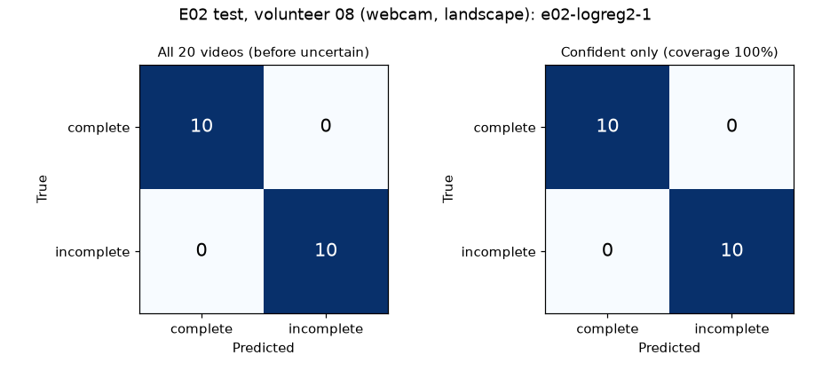
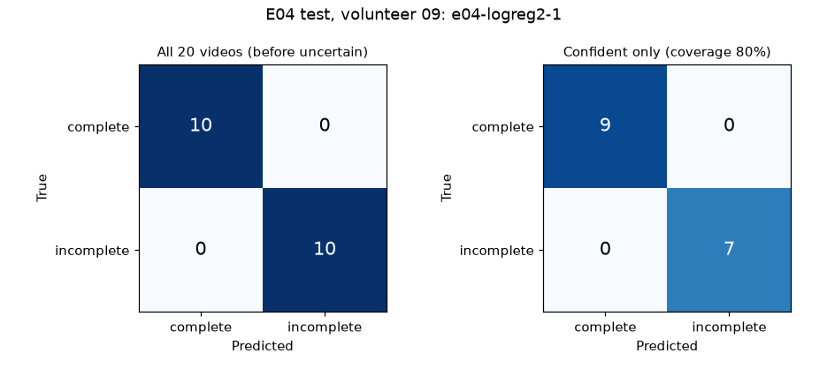
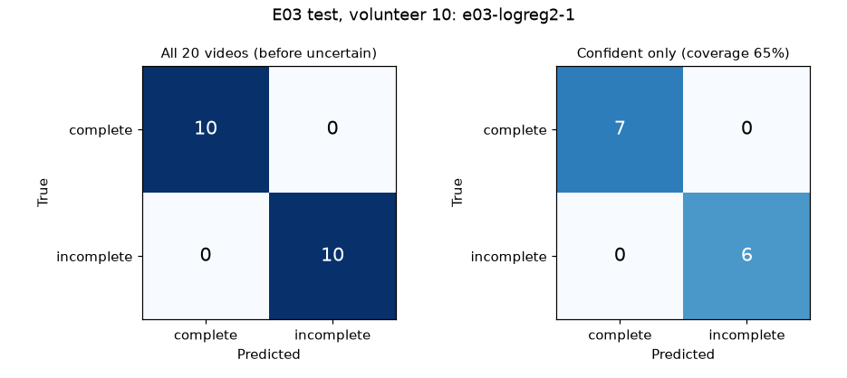
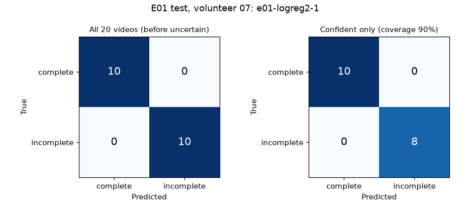

# Model Evaluation

## Four models side by side

Facts from the sections below; nothing new is computed here. LOSO = leave-one-volunteer-out cross-validation on train; BA = balanced accuracy; coverage = share of videos that are not `uncertain`. Every test volunteer was evaluated once, after the model and thresholds were committed. "Test, confident" = correct answers among the videos that were not `uncertain`.

| | E01 lifting an object | E02 elbow extension | E03 wrist lift | E04 hand opening |
|---|---|---|---|---|
| Model | `e01-logreg2-1` | `e02-logreg2-1` | `e03-logreg2-1` | `e04-logreg2-1` |
| Train volunteers (videos) | 01–05 (103) | 01–05 (107) | 02–06 (101) | 01–06 (100) |
| Test volunteer (videos) | 07 (20) | 08 (20) | 10 (20) | 09 (20) |
| LOSO BA, all videos pooled | **0.893** | 1.000 | 1.000 | 1.000 |
| LOSO BA, worst volunteer | **0.659** (volunteer 03) | 1.000 | 1.000 | 1.000 (4 of 6 volunteers have both classes) |
| LOSO coverage | **0.689** | 0.953 | 1.000 | 0.990 |
| Test, confident | 18 of 18 | 20 of 20 | 13 of 13 | 16 of 16 |
| Test coverage | 0.900 | 1.000 | **0.650** | **0.800** |
| Baseline B (one threshold) on test, BA | 1.000 | 1.000 | 1.000 | 0.850 |
| Main limitation | Noisy labels of volunteers 03 and 05; the release criteria (worst volunteer ≥ 0.85, pooled ≥ 0.90) are not met; released with a "less reliable" note in the interface | Tells "the arm stays down" from "comes back"; "down and back up" gives `uncertain` | The hand is lost on the test volunteer (small hand in a landscape webcam frame); tells "stays up" from "comes back" | Hand loss on the test volunteer (one video without any hand); volunteers 01 and 03 have one class in train; tells "stays open" from "closes again" |
| Section | [E01](#e01-lifting-an-object) | [Results](#results) | [E03](#e03-wrist-lift) | [E04](#e04-hand-opening) |

For every model: one test person and 20 videos; the health status of the volunteers is not stated in the dataset; the value shown to the user is measured, not judged. Why the hand is lost on the test volunteers: [Hand loss on the test volunteers](#hand-loss-on-the-test-volunteers).

## E02 (elbow extension)

Status: **done for model `e02-logreg2-1`.** The methodology below was fixed before training; every change made after the first results is listed in [Changes to the methodology](#changes-to-the-methodology), with the time it was made. The test volunteer 08 was evaluated **once**, after the model and all thresholds were committed. The model runs on the server since 24.11.2026, 15:38; time and memory are in [On the server](#on-the-server).

All times are Kazakhstan time (UTC+5), 24.11.2026.

## Task

Binary classification of one elbow extension (E02) cycle as `complete` or `incomplete`, with a confidence estimate; low-confidence decisions become `uncertain`. Input: the elbow angle series derived from MediaPipe hand landmarks in one video (see [Elbow angle](#elbow-angle)). One video contains one cycle. See [dataset-analysis.md](dataset-analysis.md) for the data.

## Data split

The split is strictly by volunteer ID, as required by the case specification. Videos of one person never appear in two different splits.

| Split | Volunteers | Complete | Incomplete | Purpose |
|---|---|---|---|---|
| Train | 01, 02, 03, 04, 05 | 50 | 57 | Model selection with Leave-One-Subject-Out cross-validation (LOSO-CV) |
| Test | 08 | 10 | 10 | Independent final evaluation, used once |

- **LOSO-CV:** five folds; in each fold one training volunteer is held out for validation and the model is trained on the other four. This uses all five people and shows the spread of results between people.
- **The test volunteer 08 was not used** for choosing the angle method, features, models, hyperparameters, thresholds or calibration. Its videos were first read at 15:00, after the model (commit `3acdd62`, 14:58) and the evaluation script (commit `f1b492f`, 15:00) were committed.
- The volunteer ID is parsed from the first two digits of the file name. The class label is taken from the folder name (see the label issue in [dataset-analysis.md](dataset-analysis.md#label-issue-volunteer-04)).
- Classes are close to balanced (50 / 57). Models that support it use class weights; there is no resampling.

## Elbow angle

The shoulder is outside the frame in the training videos, so the shoulder–elbow–wrist angle cannot be measured. The angle is derived from MediaPipe Hand Landmarker (`seriq_engine/hand.py`, `angles.py`):

1. Wrist (landmark 0) and the base of the middle finger (landmark 9) in pixels of each sampled frame (about 10 per second).
2. The elbow is the centre of the circle the wrist moves on. The radius is fixed to `K_FOREARM × hand length` with `K_FOREARM = 3.56`, fitted by least squares.
3. Elbow angle = 180° − forearm tilt to the horizontal of the frame. Gaps of up to 3 samples are interpolated; then a 3-sample moving average.

`K_FOREARM` was estimated on the training volunteers (median ratio of the free-circle radius to hand length on the 56 videos with an arc of at least 60°; interquartile range 3.36–3.77; 3.47–3.61 when one volunteer is left out). It is a model parameter, fixed before the test run like the `uncertain` threshold.

How the angle was checked: on those 56 videos the fixed-radius method differs from a free circle fit by 1.5° (median), 5.6° (90th percentile) per frame. **This is agreement with another computation, not with manual annotation**; no manual angle annotation exists. The elbow position was also checked visually on frames of the worst-fitting videos and of the four videos where the free circle failed.

Share of sampled frames with a detected hand, per volunteer (important for fairness: volunteer 01 has dark skin, and the rejected colour-based method failed on exactly this volunteer):

| Volunteer | Videos | Minimum | Median | Mean |
|---|---|---|---|---|
| 01 | 21 | 1.000 | 1.000 | 1.000 |
| 02 | 24 | 1.000 | 1.000 | 1.000 |
| 03 | 22 | 1.000 | 1.000 | 1.000 |
| 04 | 20 | 0.887 | 1.000 | 0.994 |
| 05 | 20 | 0.886 | 0.969 | 0.955 |
| 08 (test) | 20 | 0.976 | 1.000 | 0.998 |

## Features

Nine features per cycle (`seriq_engine/features.py`), all **relative**: differences of angles, shares of time, speeds in degrees per second. A constant shift of the whole angle series, which is what a tilted camera causes, does not change them (covered by a test). Resolution, orientation and frame rate are not used.

The main model uses two of them: `extension_range` (95th percentile of the angle minus the mean of the first 10% of samples) and `end_minus_start` (mean of the last 10% minus the mean of the first 10%).

## Models

| Role | Model | Features |
|---|---|---|
| Baseline A | Majority class (`DummyClassifier`); lower bound, BA = 0.5 | — |
| Baseline B | One threshold on `end_minus_start` (> T means complete); T is chosen inside each LOSO fold to maximise balanced accuracy | 1 |
| **Main** | Logistic regression (`class_weight="balanced"`) with sigmoid calibration (`CalibratedClassifierCV`, calibration folds = leave-one-volunteer-out inside the training data) | 2 |
| Comparison | Logistic regression, Random Forest, Gradient Boosting, SVM (RBF) | 9 |

Imputation and scaling are part of each `Pipeline` and are fitted inside every fold.

## Confidence and `uncertain`

A cycle is `uncertain` if **either** rule fires (`seriq_engine/classifier.py`). Both rules were fixed before the test run.

1. **Signal quality.** It catches changed recording conditions (another camera, light, person). The thresholds lie outside everything seen on the training data:

   | Rule | On train | `uncertain` if |
   |---|---|---|
   | Share of frames with an elbow angle | minimum 0.886 | < 0.80 |
   | Longest gap without the hand | maximum 1.41 s | > 2.0 s |
   | Number of angle points | minimum 49 | < 20 (about 2 s) |

2. **Confidence.** `confidence = max(p, 1 − p)` with calibrated `p`; `uncertain` if `confidence < 0.75`. 0.75 is a margin for the change of camera, set in advance, not tuned on out-of-fold predictions.

When the share of frames with an angle is below 0.80, the API also returns the warning `arm_not_visible`.

## Results

### LOSO-CV on train (volunteers 01–05, 107 videos)

Before the `uncertain` rule. BA = balanced accuracy. Precision, recall and F1 are given as complete / incomplete. Confusion matrix: rows = true, columns = predicted, order complete, incomplete.

| Model | BA (all folds pooled) | BA per volunteer, mean ± SD | F1 macro | Precision | Recall | F1 | Confusion matrix |
|---|---|---|---|---|---|---|---|
| Baseline A: majority | 0.500 | 0.500 ± 0.000 | 0.348 | 0.00 / 0.53 | 0.00 / 1.00 | 0.00 / 0.70 | [[0, 50], [0, 57]] |
| Baseline B: one threshold | 1.000 | 1.000 ± 0.000 | 1.000 | 1.00 / 1.00 | 1.00 / 1.00 | 1.00 / 1.00 | [[50, 0], [0, 57]] |
| **Main: logistic regression, 2 features, calibrated** | **1.000** | **1.000 ± 0.000** | **1.000** | 1.00 / 1.00 | 1.00 / 1.00 | 1.00 / 1.00 | [[50, 0], [0, 57]] |
| Logistic regression, 9 features | 0.991 | 0.991 ± 0.018 | 0.991 | 0.98 / 1.00 | 1.00 / 0.98 | 0.99 / 0.99 | [[50, 0], [1, 56]] |
| Random Forest, 9 features | 0.991 | 0.991 ± 0.018 | 0.991 | 0.98 / 1.00 | 1.00 / 0.98 | 0.99 / 0.99 | [[50, 0], [1, 56]] |
| Gradient Boosting, 9 features | 0.956 | 0.951 ± 0.077 | 0.953 | 0.91 / 1.00 | 1.00 / 0.91 | 0.95 / 0.95 | [[50, 0], [5, 52]] |
| SVM (RBF), 9 features | 0.902 | 0.901 ± 0.152 | 0.905 | 0.95 / 0.87 | 0.84 / 0.96 | 0.89 / 0.92 | [[42, 8], [2, 55]] |

Per-volunteer BA of the comparison models: the 9-feature logistic regression and Random Forest miss one video of volunteer 03 (`03_02_00_08`, incomplete: the arm rose to about 123° and stayed there). Gradient Boosting has 0.80 on volunteer 05; SVM has 0.60 on volunteer 05.

Baseline B threshold per fold: 40.4° (33.1° in the fold without volunteer 03). On the training data `end_minus_start` is at least 55.0° for complete and at most 25.7° for incomplete cycles.

Main model with the `uncertain` rule (LOSO-CV): **coverage 0.953**. 5 videos are `uncertain`, all by confidence (calibrated `p` 0.62–0.73), none by signal quality; all 5 are complete and would have been classified correctly. On the 102 confident videos: BA 1.000, F1 macro 1.000, confusion [[45, 0], [0, 57]].

### Test (volunteer 08, 20 videos, webcam, landscape), one run

Model `e02-logreg2-1`, SHA-256 `522388485921c323b687afed063ec7bd680a61abd4deff9fd45937c0f8dc9fc9`. Run at 15:00:42, code at commit `f1b492f`. Raw results: [test_vol08_metrics.json](../ml-training/results/test_vol08_metrics.json), [test_vol08_predictions.csv](../ml-training/results/test_vol08_predictions.csv).

| Model | Evaluation | BA | Precision | Recall | F1 | F1 macro | Confusion matrix | Coverage |
|---|---|---|---|---|---|---|---|---|
| Baseline A: majority | all 20 | 0.500 | 0.00 / 0.50 | 0.00 / 1.00 | 0.00 / 0.67 | 0.333 | [[0, 10], [0, 10]] | — |
| Baseline B: one threshold | all 20 | 1.000 | 1.00 / 1.00 | 1.00 / 1.00 | 1.00 / 1.00 | 1.000 | [[10, 0], [0, 10]] | — |
| **Main** | all 20, before `uncertain` | **1.000** | 1.00 / 1.00 | 1.00 / 1.00 | 1.00 / 1.00 | **1.000** | [[10, 0], [0, 10]] | — |
| **Main** | confident only | **1.000** | 1.00 / 1.00 | 1.00 / 1.00 | 1.00 / 1.00 | **1.000** | [[10, 0], [0, 10]] | **1.000** |

- No test video is `uncertain`: confidence is at least 0.903 (median 0.938); the hand is found in at least 97.6% of frames; the longest gap is 0.3 s.
- On the test videos `end_minus_start` is 81.7°–94.0° for complete and −8.6°–−0.3° for incomplete cycles: the classes are even further apart than in training.
- **20 of 20 correct is not 100% accuracy in general.** The 95% Clopper–Pearson interval for the share of correct answers is 0.832–1.000, and all 20 videos come from one person.

Angle curves of the training data: [e02_angle_curves_train.png](figures/e02_angle_curves_train.png).

## On the server

`SERIQ_MODE=model` since 24.11.2026, 15:38 (commit `25d5d46`). Before switching, `warmup()` was run inside the running container: it loads the model and creates the MediaPipe Hand Landmarker. It first failed (`libEGL.so.1` missing in the image); the image was fixed (`libegl1`, `libgles2`), and the build now runs `warmup()`, so CI catches this.

Server: VPS with 2 vCPU and 3.8 GB RAM; the backend container is limited to 2 GiB. One analysis at a time.

Measured on 24.11.2026 through the public API (`https://seriq-ai.qalau.com/api/v1/analysis`):

| Video | Size | `processing_ms` | Upload + analysis from a laptop |
|---|---|---|---|
| Portrait phone video, HEVC 1620×2880, 11.5 s (heaviest format in the dataset), two runs | 8.1 MB | 7 003 / 6 919 | 13.6 s (first run) |
| Landscape webcam video, 960×540, 14.9 s | 1.1 MB | 2 955 | 4.8 s |
| Landscape webcam video, 960×540, 13.1 s | 1.0 MB | 2 808 | not measured |

`processing_ms` is the server time from receiving the file to the response: decoding, hand landmarks on about 10 frames per second, angle, features, classifier. Upload time depends on the user's connection.

`docker stats --no-stream` of the backend, sampled about every 2 s during both analyses:

| | Memory | CPU (200% = both cores) |
|---|---|---|
| Idle | 245 MiB | 0.2% |
| During analysis, peak | 346 MiB | 167% |

The two videos used for the measurement are from the dataset (volunteers 01 and 08); they were only sent for timing, not shown anywhere, and the server deleted them after the analysis.

## Speed and resources

Measured on 25.11.2026 through the public API (`https://seriq-ai.qalau.com/api/v1/analysis`) on the server described above, with the four models loaded (`E01`–`E04` all `ready`). Only the server was read: no change to the server or the models.

**Method.** One request at a time (the next request was sent after the previous answer; the server accepts one analysis at a time), 5 runs for each exercise and length, 45 requests in total, all answered `200`. The test videos are made from one recording of the dataset (volunteer 08, webcam, 960×540): the clip was repeated and cut to 10, 30 and 60 s, encoded as H.264 at 30 fps (0.17, 0.48 and 0.97 MB). The same video was sent for `E02`, `E03` and `E04`, so only the time is meaningful, not the labels. `processing_ms` is the server time from the file to the answer; "from laptop" adds the upload over the internet connection of the laptop. p50 is the median of the 5 runs, p95 is interpolated between the two slowest runs, so with 5 runs it is close to the maximum.

| Exercise | Video | `processing_ms` p50 | `processing_ms` p95 | From laptop p50 | From laptop p95 |
|---|---|---|---|---|---|
| E02 | 10 s | 1 769 | 1 808 | 2.0 s | 2.5 s |
| E02 | 30 s | 5 396 | 5 649 | 5.9 s | 6.1 s |
| E02 | 60 s | 10 549 | 10 769 | 11.6 s | 11.9 s |
| E03 | 10 s | 1 872 | 2 029 | 2.2 s | 2.4 s |
| E03 | 30 s | 5 140 | 5 300 | 5.6 s | 5.7 s |
| E03 | 60 s | 10 666 | 10 971 | 11.5 s | 11.7 s |
| E04 | 10 s | 1 821 | 1 916 | 2.1 s | 2.3 s |
| E04 | 30 s | 5 526 | 5 651 | 5.9 s | 6.4 s |
| E04 | 60 s | 10 833 | 11 093 | 11.7 s | 11.9 s |

The time grows with the length of the video (about 0.18 s of processing per second of video for this format) and does not depend on the exercise. 4K HEVC from a phone is slower (see the measurements above and the end-to-end checks below).

**Several analyses at once** (after the queue change of 25.11): three 30 s `E02` videos sent at the same moment were all answered `200`, in 6.4, 11.9 and 17.5 s; with two videos, 6.9 and 12.4 s. In this case `processing_ms` includes the time in the queue (5.2, 10.7 and 16.2 s). A request waits up to 20 s for the free place, then gets `503 busy`.

### Sign-in next to an analysis (argon2id)

Measured on 25.11.2026 through the public API with one test account (created for the measurement and deleted afterwards with `DELETE /me`). Parameters of the password hash: argon2id, 64 MiB, 3 passes, 1 thread, at most 2 hashes at the same time (`backend/app/services/passwords.py`). The times are seen from a laptop and include the network (a request to `/health` takes about 100 ms).

| Case | n | Time of `POST /auth/login` |
|---|---|---|
| Sign-in alone | 5 | p50 278 ms, max 358 ms |
| 3 sign-ins at once while a 60 s `E02` analysis runs | 9 (3 rounds) | p50 771 ms, max 980 ms |

The analysis was not slowed down by the sign-ins: `processing_ms` of the 60 s video was 11 287, 10 405 and 10 547 (without sign-ins, 10 306 to 10 770 in the table above). One hash takes about 0.17 s on this server (the sign-in time minus the network); three sign-ins at once wait for the two places, which is why the slowest took about one second. With these numbers the parameters are kept and no password has to be re-hashed.

**Not measured:** the peak memory of the backend container while three sign-ins run next to an analysis, and other parameter sets (for example 19 MiB with 2 passes, or 128 MiB). Both need commands inside the container (`docker stats`, `docker compose exec backend python`); until they are run the choice rests on the times above.

**Not measured in this run:** the peak memory of the backend container with four models, and the start time of the server. Both need access to the server's Docker (`docker stats`, the start log). The only memory measurement so far is the one above: idle 245 MiB, peak 346 MiB during analysis (24.11, when only the `E02` model was loaded).

## End-to-end checks

Run after the switch to `model` (24.11.2026). The model, features and thresholds were not changed because of these checks.

### Own recordings

Three recordings by a team member on an iPhone (4K HEVC, rotation −90° in the metadata, read correctly), sent through the public API. The recordings show the team member's face; they are not in the repository and were not stored on the server.

| Recording | What was done | Elbow angle: start → maximum → end | Result | Expected |
|---|---|---|---|---|
| 1 | Arm lowered halfway, then raised back | 83° → 147° → 74° | `incomplete`, confidence 0.81 | `incomplete` ✓ |
| 2 | Arm lowered **to the table** (about 180°), then **raised back** | — | `uncertain`, confidence 0.55 | see below |
| 3 | No arm in the frame | — | 422 `no_pose_detected` | `no_pose_detected` ✓ |

`processing_ms` was 6.4–10.9 s: 4K HEVC is the heaviest format we have seen.

**Recording 2 is a limitation, not an error.** In the dataset a complete repetition ends with the arm lying on the table; the arm comes back up only in incomplete repetitions. A full extension followed by a return therefore looks partly like an incomplete one, and the model was not confident, so it answered `uncertain` instead of guessing. This is the behaviour the `uncertain` rule was designed for. **The recording protocol must match the dataset: lower the arm to the table and stop the recording there.** The instructions on the site and in the app are being updated to ask for this.

### Team recordings by scenario

Seven recordings by team members on an iPhone (4K HEVC, 3840×2160 with rotation metadata), one per scenario, sent through the public API with `ml-training/e2e_check.py` on 24.11.2026. Numbers only: the videos are not in the repository and were not stored on the server.

| Scenario | What was done | Expected | Result | Confidence | Elbow angle: start → max → end | `processing_ms` |
|---|---|---|---|---|---|---|
| `full` (1) | Lowered to the table and stopped | `complete` | `complete` ✓ | 0.93 | 93° → 176° → 175° | 5 948 |
| `full` (2) | Lowered to the table and stopped | `complete` | `complete` ✓ | 0.87 | 94° → 167° → 167° | 8 259 |
| `other_arm` | Other arm, from the other side | `complete` | `complete` ✓ | 0.97 | 75° → 171° → 170° | 7 122 |
| `half_back` | Lowered halfway and raised back | `incomplete` | `incomplete` ✓ | 0.90 | 93° → 141° → 80° | 9 646 |
| `full_back` | Lowered to the table and raised back | `uncertain` | `uncertain` ✓ | 0.62 | 87° → 163° → 86° | 10 409 |
| `bad_frame` | Arm partly out of the frame | `uncertain` or `no_pose_detected` | `uncertain` ✓, warning `arm_not_visible` | 0.73 | 76° → 141° → 74° | 7 660 |
| `half_hold` | Lowered halfway and **held** | not defined | `uncertain` | 0.74 | 75° → 137° → 137° | 6 294 |

6 of 6 recordings with a defined expectation matched.

- `bad_frame` is `uncertain` because of signal quality: the hand was found in 55% of the frames (rule: below 80%). Without that rule the model would have said `incomplete` with confidence 0.74, also below the threshold.
- **`half_hold` confirms the limitation found on synthetic series** (see [Known limitations](#known-limitations)). The extension from the start is 60.1°; the model gives `p_complete = 0.735` (computed locally from the same video), i.e. on the **complete** side, 0.015 below the threshold 0.75. An extension of about 3–4° more would have been classified as `complete`. The model is not changed for the reasons given there.
- `processing_ms` is 6–10 s for 4K HEVC; upload time comes on top (about 0.5 MB/s on the connection used, 12–24 MB per recording).

### Edge cases on the server

Synthetic files made with ffmpeg from a test pattern (no people, no dataset videos), sent through the public API:

| File | Response | Time |
|---|---|---|
| 61 s video | 422 `video_too_long` | 0.9 s |
| Random bytes after a valid mp4 signature | 422 `video_unreadable` | 1.0 s |
| mp4 cut to a third of its size | 422 `video_unreadable` | 0.5 s |
| 5 s video without a hand | 422 `no_pose_detected` | 1.5 s |
| 5 s webm without duration in the metadata (as browsers record), no hand | 422 `no_pose_detected` | 5.7 s |
| 1 s video | 422 `video_too_short` | 0.5 s |

A webm without duration takes longer: the server first decodes the whole file to count the frames.

### Mirrored video

Arm on the other side of the frame: two training videos (one complete, one incomplete) flipped horizontally, analysed locally and compared with the same videos re-encoded without flipping:

| Video | Original | Mirrored | Angle difference per frame |
|---|---|---|---|
| Complete | `complete`, 0.945 | `complete`, 0.935 | median 0.8°, max 2.2° |
| Incomplete | `incomplete`, 0.940 | `incomplete`, 0.942 | median 0.3°, max 0.7° |

The side of the arm is detected automatically. These two videos are from the training set, so this checks the mirroring, not the accuracy.

## Changes to the methodology

Made after results were seen, all **before any access to volunteer 08**:

| Time | Change | Reason |
|---|---|---|
| about 14:00–14:30 | Pose Landmarker replaced by Hand Landmarker; elbow from a fixed-radius circle; `K_FOREARM = 3.56` | The shoulder is outside the frame; Pose found a pose in 0–60% of frames. A colour skin mask was rejected: it lost up to 79% of frames for volunteer 01 (dark skin) |
| 14:37 | First LOSO-CV results (commit `84ccc16`): the planned baseline (logistic regression on 2 features) reached BA 1.000, all candidates were not better | — |
| 14:58 | Baseline redefined: A = majority class, B = one threshold on one feature. Main model = the former baseline (logistic regression on 2 features), now calibrated (commit `fe97478`) | The 2-feature model was not worse than the complex ones and is simpler and less likely to depend on the camera; a baseline must be simpler than the main model for the comparison to mean something |
| 14:58 | `uncertain` threshold fixed at 0.75 in advance, plus signal-quality rules, instead of a trade-off chosen on out-of-fold predictions; sigmoid calibration always applied | On LOSO-CV the out-of-fold predictions had no borderline cases, so a threshold chosen on them would be arbitrary |

**LOSO-CV is not fully clean:** the angle method and `K_FOREARM` were chosen while looking at all five training volunteers, including the one held out in each fold. The LOSO numbers are therefore somewhat optimistic; the test on volunteer 08 is not affected.

## Known limitations

- **One test person, 20 videos.** The test does not show how the model works for other people, especially for patients after a stroke. The health status of the volunteers is not stated in the dataset.
- **The task is easy on this dataset.** A single threshold (baseline B) is as good as the main model on both LOSO-CV and the test. In the incomplete videos the arm comes back without extending; real partial extensions (for example, stopping at 140°) are rare. One such video (`03_02_00_08`) exists in train.
- **The angle is an estimate**: 180° − forearm tilt, assuming the upper arm lies on the table. The absolute angle depends on camera tilt (up to about 190° in training), which is why the features are relative. The API clips `angle_series` to 0–180° for the chart only.
- **Recording protocol:** the model expects the dataset protocol: one repetition that ends with the arm on the table. A repetition "down and back up" gives `uncertain` (own recording 2). A feature based on the maximum angle and cycle segmentation could handle it, but a new model could not be evaluated honestly any more: the test volunteer has already been used.
- **Partial extension with a hold** (synthetic check, not a metric). The saved model was run on synthetic angle series "start at 90°, smooth rise, hold 1–2 s at the peak": extension from the start of up to about 33° → `incomplete`; about 36–60° → `uncertain` (confidence 0.53–0.73); from about 63° → `complete` (with a start at 90° that is a peak of about 153°). The hold time does not change the result; only the difference from the start angle does. So with the new protocol "lower the arm and stop", a partial extension that stops at about 153–170° can be classified as `complete`. The reason: the dataset has no incomplete repetitions with a hold (in its incomplete videos the arm comes back). The model is not retrained, because the test volunteer has already been used and a new model could not be evaluated honestly. The chart always shows the measured angle, so the user sees, for example, "up to 150°". Confirmed on a live recording (`half_hold`, see [Team recordings](#team-recordings-by-scenario)): extension 60.1°, `p_complete = 0.735`, `uncertain` by a margin of 0.015.
- **Camera:** training videos are portrait phone recordings, the test videos landscape webcam recordings. The model passed this one change of camera; other setups (arm not starting from the left edge, the elbow not resting, other angles of view) were not tested.
- **Hand detection and skin tone:** checked on six volunteers only. The detection rate was ≥ 0.886 for every video of every volunteer, including volunteer 01 with dark skin, but six people is not a fairness evaluation.
- **Missing frames:** in two training videos the hand disappears at the end (`04_02_00_03`: the last 13 samples, `05_02_00_06`: 1 sample). They are kept; gaps are handled in `angles.py`.
- **Labels of volunteer 04** are inconsistent between folder and file name; the folder is used.
- **Calibration is conservative:** in LOSO-CV 5 correctly classified complete videos were `uncertain` (confidence 0.62–0.73). Users will sometimes see "check the instructions" after a correct repetition.

## E04 (hand opening)

Status: model `e04-logreg2-1`; the test run was made on 24.11.2026 at 23:31 Kazakhstan time (UTC+5). The method is the same as for E02: one cycle per video, relative features, LOSO-CV by volunteer, `uncertain` thresholds set before the test run, the test volunteer used once.

### Data

| Split | Volunteers | Complete | Incomplete |
|---|---|---|---|
| Train | 01–06 | 50 | 50 |
| Test | 09 | 10 | 10 |

Classes come from the folder name. No mismatch between folder and file name and no repeated file names were found in E04. **Volunteer 01 has only incomplete videos (10) and volunteer 03 only complete ones (9) in train.** Balanced accuracy of these two folds is undefined, so the "per volunteer" mean in the table below is taken over the four volunteers who have both classes (02, 04, 05, 06).

### Signal

Mean distance from the five fingertips (landmarks 4, 8, 12, 16, 20) to the wrist (0), divided by the palm size (distance 0 → 9), as a percentage of the start of the recording (mean of the first 10% of samples). It does not depend on the scale, mirroring or rotation of the hand in the frame (covered by tests). `measure.value` = the maximum of this series. The hand was found in 100% of the frames in every train video. Curves: [e04_signal_train.png](figures/e04_signal_train.png).

On train the maximum alone does not separate the classes (complete 169–224%, incomplete 127–203%). The value at the end of the recording does: in a complete cycle the hand stays open, in an incomplete one it returns. As for E02, the classifier mainly tells "stays open" from "returns", not how wide the hand opened.

### LOSO-CV on train (100 videos)

Before the `uncertain` rule. Confusion matrix: rows = true, columns = predicted, order complete, incomplete.

| Model | BA (all folds pooled) | BA per volunteer, mean ± SD (4 volunteers) | F1 macro | Confusion matrix |
|---|---|---|---|---|
| Baseline A: majority | 0.400 | 0.500 ± 0.000 | 0.286 | [[0, 50], [10, 40]] |
| Baseline B: one threshold on `extension_range` | 0.920 | 0.915 ± 0.054 | 0.920 | [[47, 3], [5, 45]] |
| **Main: logistic regression, 2 features, calibrated** | **1.000** | **1.000 ± 0.000** | **1.000** | [[50, 0], [0, 50]] |
| Threshold on `end_minus_start` | 1.000 | 1.000 ± 0.000 | 1.000 | [[50, 0], [0, 50]] |
| Logistic regression, `extension_range` only | 0.940 | 0.939 ± 0.042 | 0.940 | [[47, 3], [3, 47]] |
| Logistic regression, 9 features | 0.990 | 0.988 ± 0.022 | 0.990 | [[49, 1], [0, 50]] |
| Random Forest, 9 features | 0.980 | 0.975 ± 0.043 | 0.980 | [[48, 2], [0, 50]] |
| SVM (RBF), 9 features | 0.970 | 0.965 ± 0.038 | 0.970 | [[49, 1], [2, 48]] |

With the `uncertain` rule (same thresholds as E02: confidence below 0.75, hand found in less than 80% of frames, a gap longer than 2 s, fewer than 20 points): coverage 0.990, one video `uncertain` by confidence, none by signal quality; BA on the 99 confident videos 1.000. A single threshold on `end_minus_start` is as good as the main model, as for E02.

### Test (volunteer 09, 20 videos), one run

Model `e04-logreg2-1`, SHA-256 `0e0cf6728ec94285c5f94996a357d50eb8a969fb9c3f27652e3411512069844e`, committed before the run (commit `2a99d90`, script `evaluate_exercise.py` committed before as well). Raw results: [e04_test_metrics.json](../ml-training/results/e04_test_metrics.json), [e04_test_predictions.csv](../ml-training/results/e04_test_predictions.csv).

| Model | Evaluation | BA | F1 macro | Confusion matrix | Coverage |
|---|---|---|---|---|---|
| Baseline A: majority | all 20 | 0.500 | 0.333 | [[0, 10], [0, 10]] | — |
| Baseline B: one threshold on `extension_range` | all 20 | 0.850 | — | [[8, 2], [1, 9]] | — |
| **Main** | confident only (16 videos) | **1.000** | **1.000** | [[9, 0], [0, 7]] | **0.800** |
| Main | all 20, before `uncertain` | 1.000 | 1.000 | [[10, 0], [0, 10]] | — |

- **4 of 20 test videos are `uncertain`, all by signal quality, none by confidence.** The hand is found in 71–100% of the frames in 19 videos; in one incomplete video (`09_04_00_05`) **it was not found at all**. The other three: the hand is lost for 2.2 s, 2.4 s and 5.2 s. The rule did what it was made for. In train the hand was found in every frame, so this loss is a result of the other recording conditions, not of the model.
- **The "all 20" row is not a clean accuracy.** For `09_04_00_05` there is no signal; the table counts it as `incomplete` only because the model, fed an empty feature vector, returned `p_complete = 0.378`. The reliable number is the confident-only row: 16 of 16 correct.
- Confidence of the 16 confident videos is at least 0.808; the maximum opening is 151–215% for the confident videos.
- **16 of 16 is not 100% accuracy in general.** All videos are one person, 20 videos. With 16 results the 95% Clopper–Pearson interval for the share of correct answers is 0.794–1.000.

### Changes to the methodology (all before the test volunteer was read)

| Step | Change | Reason |
|---|---|---|
| First LOSO-CV run | The calibration of E02 (nested leave-one-volunteer-out, one calibrator per fold, averaged) gave coverage 0.390 with 0 errors: 61 of 100 videos `uncertain` by confidence | The held-out part of the folds of volunteers 01 and 03 contains one class, so their calibrators are degenerate and pull the confidence to 0.5 |
| Before fixing the model | For E04 the calibrator is fitted once on all out-of-fold predictions (`CalibratedClassifierCV(ensemble=False)`). Features, the 0.75 threshold and the signal-quality thresholds are unchanged. Coverage 0.990. E02 and E03 keep their calibration | Fixes the single-class folds; chosen on train only |
| Before fixing the model | The mean over volunteers in `train.py` skips volunteers with one class | BA is undefined for them. The E02 numbers do not change |

### Limitations

- One test person and 20 videos; the health status of the volunteers is not stated in the dataset.
- Two training volunteers have one class only, so per-volunteer results are available for four of six.
- The model separates "stays open" from "returns", like E02. It does not measure how wide the hand opened; the value shown to the user is measured, not judged.
- Hand loss in the test videos (one video without any detection) shows that recording conditions matter; the user sees "check the instructions" and a hint to show the whole hand.
- Only the standard Hand Landmarker was tested; other cameras and light were not.

## E03 (wrist lift)

Status: model `e03-logreg2-1`; the test run was made on 24.11.2026 (Kazakhstan time, UTC+5). Same method as E02 and E04: one cycle per video, relative features, LOSO-CV by volunteer, `uncertain` thresholds fixed before the test run, the test volunteer used once. The signal module and the first training script were written by danshikdev.

### Data

| Split | Volunteers | Complete | Incomplete |
|---|---|---|---|
| Train | 02–06 | 50 | 51 |
| Test | 10 | 10 | 10 |

Classes come from the folder name. No mismatch between folder and file name and no repeated file names were found. Every train volunteer has both classes.

### Signal

Angle of the vector from the wrist (0) to the middle of the palm (9), measured from its direction at the start (mean of the first 10% of samples), in degrees, positive when the hand goes up. The vector is mirrored by its start direction, so the lift is positive when the arm enters from either side of the frame (covered by tests). `measure.value` = the maximum of this series. In train the hand was found in at least 99.4% of the frames of every video. Curves: [e03_signal_train.png](figures/e03_signal_train.png).

On train the maximum lift alone almost separates the classes (complete 71–140°, incomplete 30–82°, a small overlap). The value at the end of the recording and the drop from the peak separate them: `end_minus_start` is 69.2–138.2° for complete and −30.7–14.0° for incomplete; `return_from_peak` is −0.9–10.1° for complete and 33.5–89.3° for incomplete. As for E02, the classifier mainly tells "the hand stays up" from "the hand comes back down", not how high it was lifted.

### LOSO-CV on train (101 videos)

Before the `uncertain` rule. Confusion matrix: rows = true, columns = predicted, order complete, incomplete.

| Model | BA (all folds pooled) | BA per volunteer, mean ± SD | F1 macro | Confusion matrix |
|---|---|---|---|---|
| Baseline A: majority | 0.453 | 0.500 ± 0.000 | 0.417 | [[10, 40], [15, 36]] |
| Baseline B: one threshold on `extension_range` | 0.911 | 0.917 ± 0.056 | 0.911 | [[47, 3], [6, 45]] |
| **Main: logistic regression, 2 features, calibrated** | **1.000** | **1.000 ± 0.000** | **1.000** | [[50, 0], [0, 51]] |
| Threshold on `end_minus_start` | 1.000 | 1.000 ± 0.000 | 1.000 | [[50, 0], [0, 51]] |
| Logistic regression, `extension_range` only | 0.960 | 0.953 ± 0.045 | 0.960 | [[48, 2], [2, 49]] |
| Logistic regression, 9 features | 0.990 | 0.990 ± 0.020 | 0.990 | [[49, 1], [0, 51]] |
| Random Forest, 9 features | 1.000 | 1.000 ± 0.000 | 1.000 | [[50, 0], [0, 51]] |
| SVM (RBF), 9 features | 1.000 | 1.000 ± 0.000 | 1.000 | [[50, 0], [0, 51]] |

With the `uncertain` rule (same thresholds as E02): coverage 1.000, none `uncertain`; BA 1.000 on all 101 videos. A single threshold on `end_minus_start` is as good as the main model, as for E02 and E04. Raw results: [e03_loso_metrics.json](../ml-training/results/e03_loso_metrics.json).

### Test (volunteer 10, 20 videos), one run

Model `e03-logreg2-1`, SHA-256 `8e0fd6e624ca6129...` (full value in the JSON), committed and pushed before the run. Raw results: [e03_test_metrics.json](../ml-training/results/e03_test_metrics.json), [e03_test_predictions.csv](../ml-training/results/e03_test_predictions.csv).

| Model | Evaluation | BA | F1 macro | Confusion matrix | Coverage |
|---|---|---|---|---|---|
| Baseline A: majority | all 20 | 0.500 | 0.333 | [[0, 10], [0, 10]] | — |
| Baseline B: one threshold on `extension_range` | all 20 | 1.000 | 1.000 | [[10, 0], [0, 10]] | — |
| Main | all 20, before `uncertain` | 1.000 | 1.000 | [[10, 0], [0, 10]] | — |
| **Main** | confident only (13 videos) | **1.000** | **1.000** | [[7, 0], [0, 6]] | **0.650** |

- **7 of 20 test videos are `uncertain`, all by signal quality, none by confidence.** In these videos the hand is lost for 2.2–6.6 s (hand found in 57–88% of the frames); in train the hand was found in at least 99.4% of the frames. The recording conditions of the test volunteer differ from train, and the user would see "check the instructions" in a third of the cases even when the repetition was correct. Coverage 0.650 is the weakest number of the three exercises.
- Without the signal-quality rule the model would have classified all 20 videos correctly, with calibrated confidence at least 0.85 for complete and the probability of complete at most 0.20 for incomplete. This says the lost frames did not break the direction of the answer here; it is not a reason to relax the rule, which was fixed before the test.
- **20 of 20 is not 100% accuracy in general.** All videos are one person. For the 13 confident videos the 95% Clopper–Pearson interval for the share of correct answers is 0.753–1.000.
- On the test videos the maximum lift is 74.7–135.0° for complete and 13.9–65.3° for incomplete.

### Changes to the methodology (all before the test volunteer was read)

| Step | Change | Reason |
|---|---|---|
| First LOSO-CV run (danshikdev) | Main model on `extension_range` and `end_minus_start`: 0 errors, coverage 0.950 (5 videos `uncertain` by confidence) | — |
| Before fixing the model | Features changed to `end_minus_start` and `return_from_peak` (value at the end and the drop from the peak), as proposed by the project lead. Calibration unchanged. On train: 0 errors, coverage 1.000, minimum confidence 0.77. The two other sets tried (`extension_range` + `end_minus_start`, `end_minus_start` alone) also had 0 errors, coverage 0.95 and 0.99 | The new set describes "the hand stays up" directly and has a higher coverage on train; chosen on train only |

### Limitations

- One test person and 20 videos; the health status of the volunteers is not stated in the dataset.
- **Coverage on the test volunteer is 0.650** because the hand is lost for seconds in several videos. In the app the user sees "check the instructions" and a hint to show the whole hand.
- The model separates "stays up" from "comes back", like E02 and E04. It does not measure how high the hand was lifted; the value shown to the user is measured, not judged.
- The signal is the rotation of the hand in the image plane: it assumes a side view of the forearm, like in the dataset. Other camera positions were not tested.

## E01 (lifting an object)

Status: model `e01-logreg2-1`; the test run was made once on 24.11.2026 after the model and all thresholds were committed and pushed. **E01 is the weakest of the four models on train: the classes overlap, and for volunteers 03 and 05 they are mixed.** It is released at the request of the developer despite not meeting the release criteria set during the work (worst volunteer BA at least 0.85, all videos together at least 0.90), see [Limitations](#limitations-2).

### Data

| Split | Volunteers | Complete | Incomplete |
|---|---|---|---|
| Train | 01–05 | 52 | 51 |
| Test | 07 | 10 | 10 |

Classes come from the folder name. No mismatch between folder and file name and no repeated file names. Task: a person takes a bottle from the table, lifts it and puts it back; complete = the bottle is lifted high, incomplete = lifted a little.

### Signal

Rise of the wrist (point 0) upward from its start position (mean of the first 10% of samples), in hand lengths (median distance wrist → middle of the palm in the video). Hand lengths make it independent of resolution and distance to the camera; tests cover scale, mirrored side and no hand. `measure` = `lift_height`, unit `hand_lengths`, value = the maximum of the series. In train the hand was found in 99.4–100% of the frames of every video.

Features: `lift_area` (mean of the series, negative values set to 0), `lift_above1` (share of time above one hand length); the common features of E02 are also computed for the comparison models.

On train the 95th percentile of the series is 3.51 ± 0.62 for complete and 1.95 ± 0.67 for incomplete, but **the peak overlaps between classes**: for volunteer 03 incomplete reaches 3.58 and complete starts at 1.75; for volunteer 05 one incomplete video reaches 4.29 while the other incomplete videos are at 1.96–2.74. Shape features (hold at the top, rise speed, peak width, time to the peak) did not help: unlike E02–E04, the bottle is lifted and put back in both classes, so "stays in the final pose" does not work.

Frames of volunteers 03 and 05 were looked at locally (not saved in the repository): the wrist is tracked correctly, and some incomplete videos look as high at the peak as complete ones (03: incomplete 3.58 and complete 3.62 look the same; 05: one incomplete is higher than a complete). This points to the labels, not to tracking, so the signal was not changed.

### LOSO-CV on train (103 videos)

Confusion matrix: rows = true, columns = predicted, order complete, incomplete.

| Model | BA (all folds pooled) | BA per volunteer, mean ± SD | F1 macro | Confusion matrix |
|---|---|---|---|---|
| Baseline A: majority | 0.465 | 0.500 ± 0.000 | 0.459 | [[30, 22], [33, 18]] |
| Baseline B: one threshold on `extension_range` | 0.805 | 0.795 ± 0.181 | 0.804 | [[46, 6], [14, 37]] |
| **Main: logistic regression, `lift_area` + `lift_above1`, calibrated** | **0.893** | **0.885 ± 0.132** | **0.893** | [[48, 4], [7, 44]] |
| Threshold on `end_minus_start` | 0.516 | 0.526 ± 0.109 | 0.501 | [[18, 34], [16, 35]] |
| Logistic regression, `extension_range` only | 0.864 | 0.852 ± 0.140 | 0.864 | [[45, 7], [7, 44]] |
| Logistic regression, 9 features | 0.835 | 0.819 ± 0.130 | 0.835 | [[43, 9], [8, 43]] |
| Random Forest, 9 features | 0.873 | 0.858 ± 0.122 | 0.874 | [[47, 5], [8, 43]] |
| SVM (RBF), 9 features | 0.844 | 0.830 ± 0.134 | 0.845 | [[45, 7], [9, 42]] |

Main model, BA per volunteer: 01 — 1.000, 02 — 1.000, 03 — **0.659**, 04 — 0.955, 05 — **0.814**.

With the `uncertain` rule (threshold 0.75, signal quality as for E02): **coverage 0.689, 32 of 103 videos are `uncertain`** (all by confidence, none by signal quality); on the 71 confident videos BA 0.959, confusion matrix [[40, 2], [1, 28]]. Raw results: [e01_loso_metrics.json](../ml-training/results/e01_loso_metrics.json).

### Test (volunteer 07, 20 videos), one run

Model `e01-logreg2-1`, SHA-256 `97902e0ab9d1d5c1...` (full value in the JSON), commit `83ac59a`, pushed before the run. Raw results: [e01_test_metrics.json](../ml-training/results/e01_test_metrics.json), [e01_test_predictions.csv](../ml-training/results/e01_test_predictions.csv).

| Model | Evaluation | BA | F1 macro | Confusion matrix | Coverage |
|---|---|---|---|---|---|
| Baseline A: majority | all 20 | 0.500 | — | [[10, 0], [10, 0]] | — |
| Baseline B: one threshold on `extension_range` | all 20 | 1.000 | 1.000 | [[10, 0], [0, 10]] | — |
| Main | all 20, before `uncertain` | 1.000 | 1.000 | [[10, 0], [0, 10]] | — |
| **Main** | confident only (18 videos) | **1.000** | **1.000** | [[10, 0], [0, 8]] | **0.900** |

- **2 of 20 test videos are `uncertain`**: one by confidence (probability of complete 0.26) and one by signal quality (`07_01_00_08`, maximum lift −0.02, an incomplete video). All 10 complete videos are confident and correct.
- On the test videos the maximum lift is 4.01–5.52 hand lengths for complete and −0.02–1.96 for incomplete: a wide gap, unlike the train volunteers 03 and 05.
- **The test result must not be read as the quality of the model.** One volunteer, 20 videos, and this volunteer is separable by almost any threshold (baseline B also has 1.000). On train the picture is worse: BA 0.893, and 0.659 for volunteer 03. For the 18 confident videos the 95% Clopper–Pearson interval for the share of correct answers is 0.815–1.000.

### Changes to the methodology (all before the test volunteer was read)

| Step | Change | Reason |
|---|---|---|
| Reconnaissance on train | Signal: wrist rise in hand lengths; the maximum of the raw series overlaps between classes | — |
| Choice of features, train only | Features `lift_area` and `lift_above1` chosen by LOSO-CV on train among a few sets (`peak`, `range`, `area`, `range`+`area`, with rise speed, time above levels). Best by pooled BA: `area` alone, 0.903; the pair with `lift_above1` has 0.893 | Quick choice on train; the differences between the sets are small and not tested for stability |
| Before fixing the model | Looked at frames of volunteers 03 and 05 (train): tracking is correct, labels look mixed; the signal was not changed. The release criteria (see the status) are not met; the model is released at the developer's request | Decision of the developer |

### Limitations

- **Train labels are noisy for volunteers 03 and 05; no feature of the curve separates them.** In the app incorrect answers are likely for lifts of medium height (about 2–3.5 hand lengths); coverage on train is 0.689, so about a third of such repetitions end as `uncertain`.
- One test person and 20 videos; the health status of the volunteers is not stated in the dataset.
- The signal is the vertical movement of the wrist in the image; the camera should be fixed with the hand lifting upward in the frame. Other camera angles were not tested.
- The value shown to the user is measured, not judged.

## Hand loss on the test volunteers

Status: analysis and an optional fix, **switched off for every exercise**. No model, feature or threshold was changed, and no model was run again on a test volunteer: the numbers below are only the share of frames with a detected hand and the number of videos that pass the signal-quality rule, which depends on the detected frames only (not on the model or the labels). Script: [hand_recovery.py](../ml-training/hand_recovery.py), raw numbers: [hand_recovery.json](../ml-training/results/hand_recovery.json).

### Why the hand is lost

On train the hand is found in 99.4–100% of the frames of every video; on the test volunteers of E03 and E04 it is lost for seconds. The main difference is **the size of the hand in the frame**: the test videos are landscape webcam recordings where the hand is 2–2.5 times smaller.

| | Hand length in the frame (wrist → middle finger base), median | Shortest | Where the missing frames are |
|---|---|---|---|
| E03 train | 133 px | 82 px | — (one frame) |
| E03 test, volunteer 10 | **54 px** | 27 px | 95% in the first third (the fist resting before the lift) |
| E04 train | 131 px | 60 px | none |
| E04 test, volunteer 09 | **72 px** | 41 px | 59% first third, 21% middle, 20% last third |

The MediaPipe palm detector looks at the whole frame scaled down to 192 × 192 pixels, where such a hand is a few pixels wide. Lowering the detection thresholds (0.3 → 0.1 → 0.05) and scaling the whole frame up 2× did not find the hand on any of the checked frames of `10_03_01_05` before the 6th second: both keep the hand equally small relative to the frame. A closed fist lying on its side is the hardest case for the detector.

### Optional fix: a second pass around the hand

`seriq_engine.hand.recover_missing`: only for the frames where the hand was not found, a square window around the hand of the nearest frame where it was found (side 5 × hand length, at least 160 px) is cut out, scaled to 384 × 384 and passed to the detector again; the points are mapped back to the frame. The window size was set in advance, not tuned on the test videos. It is enabled per exercise with `RECOVER_HAND = True` in the exercise module; **it is off for E01–E04**, so the server answers do not change (the regression tests on 24 train videos pass byte for byte).

| | Share of frames with a hand, before → after | Worst video, before → after | Videos passing the signal-quality rule, before → after |
|---|---|---|---|
| E01 test, volunteer 07 (20 videos) | 1.000 → 1.000 | 1.000 → 1.000 | 19 → 19 |
| E03 test, volunteer 10 (20 videos) | 0.903 → **0.995** | 0.574 → **0.922** | 13 → **20** |
| E04 test, volunteer 09 (20 videos) | 0.907 → **0.943** | 0.000 → 0.000 | 16 → **19** |
| E01, E03, E04 train (304 videos) | 1.000 → 1.000 | unchanged (one E03 frame recovered) | all pass → all pass |

- E01 has no hand loss on its test volunteer: the one video that fails the rule (`07_01_00_08`) is 0.9 s long, and the API rejects it as `video_too_short` anyway.
- In E04 `09_04_00_05` the hand is not found in any frame, so the second pass has nothing to start from; the API answers `no_pose_detected`.
- The recovered hands are plausible in size: hand length in the recovered frames divided by the median of the originally found frames is 1.027 (5th–95th percentile 0.821–1.168) for E03 (332 frames) and 0.992 (0.876–1.042) for E04 (132 frames). The positions of the points were not checked against a manual annotation.

### What this does and does not show

- The low coverage on the test volunteers of E03 (0.650) and E04 (0.800) comes mostly from the detector missing a small hand, not from the classifiers.
- With the second pass all 20 E03 test videos and 19 of 20 E04 test videos would pass the signal-quality rule. **What the models would answer on them is not known and was deliberately not computed**: the test volunteers were already used, and the published coverage and metrics remain those of the single test run.
- Switching the fix on changes the answers of the server for that exercise. It is a team decision; if it is switched on, the change and its reason have to be stated next to the test results of that exercise, and a clean measurement needs new people.
